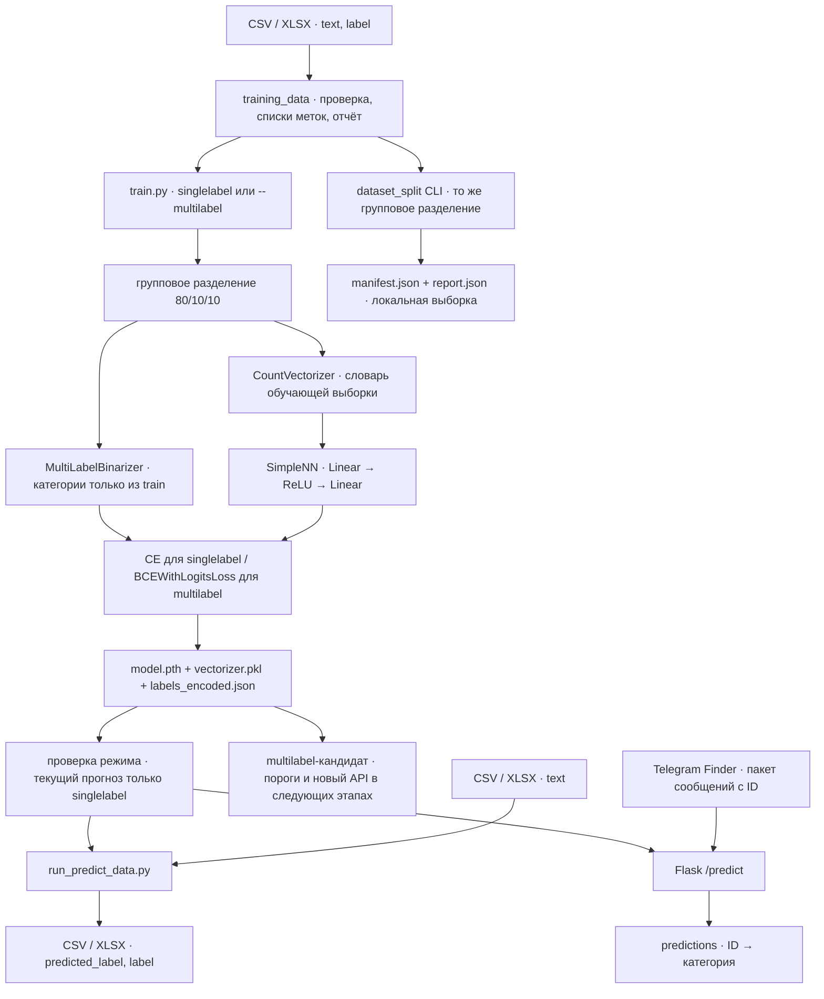

# Архитектура

Чекпоинт 4: `evaluate_multilabel.py` отдельно подбирает пороги по validation и оценивает независимый test с зафиксированным `selection.json`. Сравниваются хеши трёх файлов кандидата, исходной таблицы и состав разделения. Локальные аналитические отчёты не изменяют контракт модели. Подробнее: [пороги и оценка](EVALUATION.md). Подключение выбранных порогов к рабочему прогнозу остаётся в следующих этапах.

Входной размер первого слоя равен длине словаря, скрытый слой содержит 100 нейронов, выходной слой соответствует числу категорий. JSON связывает целочисленный индекс выхода с названием класса. JSON-ключи при чтении переводятся в числа либо выбираются по строковому представлению индекса.

Веса сохраняются как state_dict с ключами fc1 и fc2. Векторизатор переносится вместе с весами, поскольку позиция каждого признака зависит от словаря. Сервер загружает комплект при создании приложения. Для singlelabel на запрос выполняются векторизация и выбор максимального выхода. Вычисления сервера идут на CPU.

С 11.11.2026 загрузчик `utils/training_data.py` разбирает `label` по `|`, нормализует список категорий и исключает строки с ошибками или незавершённой проверкой. Полные правила и команды приведены в [документации обучения](TRAINING.md). Загрузчик не назначает числовой класс составной метке. MultiLabelBinarizer задаёт алфавитный порядок категорий только по train; необученные категории контрольных частей вызывают ошибку. Флаг `--multilabel` включает float multi-hot цели и BCEWithLogitsLoss; без флага сохраняется обучение одиночных меток с CrossEntropyLoss. Архитектура SimpleNN и структуры трёх артефактов сохранены.

`utils/dataset_split.py` объединяет записи по ID и нормализованному тексту, исключает конфликтующие группы, убирает повторы и делит целые группы на обучение, валидацию и тест. Тот же алгоритм используется в `train.py`; MultiLabelBinarizer и CountVectorizer обучаются только на обучающей части. Манифест состава частей и отчёт можно сохранить отдельно командой подготовки данных. Multilabel пока выводит валидационный BCE без подбора порогов и не оценивает независимый тест. Однокатегорийная модель по-прежнему оценивается на тесте.

`utils/training.py` сохраняет во векторизаторе необязательные атрибуты режима, конфигурации и истории обучения. Тип CountVectorizer, плоский JSON меток и state_dict не меняются. Текущие сервер и пакетный прогноз допускают только `classification_task_=singlelabel` либо прежний векторизатор без этого атрибута. Помеченный multilabel-кандидат отклоняется до argmax. Новый формат выдачи и перенос в Finder запланированы в [Roadmap](ROADMAP.md).
