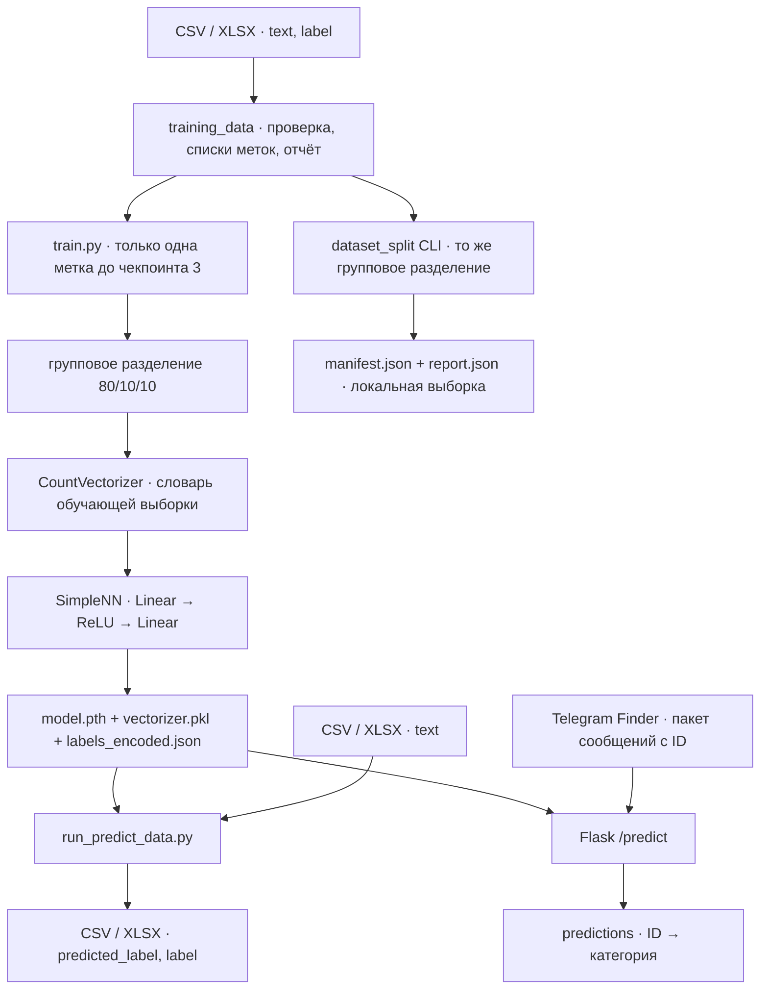

# Архитектура

Входной размер первого слоя равен длине словаря, скрытый слой содержит 100 нейронов, выходной слой соответствует числу категорий. JSON связывает целочисленный индекс выхода с названием класса. JSON-ключи при чтении переводятся в числа либо выбираются по строковому представлению индекса.

Веса сохраняются как state_dict с ключами fc1 и fc2. Векторизатор переносится вместе с весами, поскольку позиция каждого признака зависит от словаря. Сервер загружает комплект при создании приложения. На запрос выполняются векторизация и выбор максимального выхода. Вычисления сервера идут на CPU.

С 11.11.2026 загрузчик `utils/training_data.py` разбирает `label` по `|`, нормализует список категорий и исключает строки с ошибками или незавершённой проверкой. Полные правила и команда проверки приведены в [документации обучения](TRAINING.md). Загрузчик не назначает числовой класс составной метке. Пока обучение использует cross entropy, `train.py` явно отклоняет подготовленный набор с несколькими метками в строке. На однокатегорийном наборе LabelEncoder применяется только после этой проверки. Форматы действующих трёх артефактов и ответа API остаются прежними; переход на multilabel-обучение и прогноз описан в [Roadmap](ROADMAP.md).

`utils/dataset_split.py` объединяет записи по ID и нормализованному тексту, исключает конфликтующие группы, убирает повторы и делит целые группы на обучение, валидацию и тест. Тот же алгоритм используется в `train.py`; LabelEncoder и CountVectorizer обучаются только на обучающей части. Манифест состава частей и отчёт можно сохранить отдельно командой подготовки данных. Валидация зарезервирована для будущего подбора порогов; текущая итоговая оценка однокатегорийной модели выполняется на тесте.
